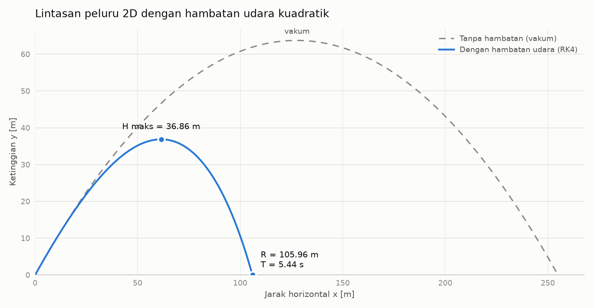

<h1 align="center">fortran-ballistics-sim</h1>

<p align="center"><b>Numerical Simulation of Two-Dimensional Projectile Motion with Quadratic Air Drag<br>Using the Fourth-Order Runge-Kutta Method in Fortran 2008</b></p>

<p align="center">NuRichter</p>

**_Abstract_.** This repository presents a simulation of two-dimensional projectile
motion under uniform gravity and quadratic aerodynamic drag. The resulting nonlinear
first-order system of ordinary differential equations (ODEs) is integrated with the
classical fixed-step fourth-order Runge-Kutta (RK4) method in IEEE 754 double precision.
A bisection-based event locator finds the apex and the impact point to the accuracy of
the integrator rather than to the resolution of the time step. The implementation is
verified against the vacuum analytic solution at five elevation angles with a maximum
relative error of 2.4 × 10⁻¹³, and a convergence study yields an empirical order of
4.02, in agreement with the theoretical order of the method. For a sphere with a
diameter of 74 mm and a mass of 145 g launched at 50 m/s and 45°, air drag reduces the
range from 254.93 m to 105.96 m (−58.4%) and shifts the optimum elevation angle from
45° to 38.5°.

**_Index Terms_.** Projectile motion, quadratic drag, Runge-Kutta method, event
location, Fortran 2008, numerical verification.

---

## I. Introduction

Projectile motion without air resistance has a closed-form parabolic solution [1].
A drag force proportional to the square of the speed couples the horizontal and
vertical components nonlinearly. No general analytic solution then exists, and the
trajectory must be computed numerically [1].

This repository contributes (i) a double-precision RK4 implementation in standard
Fortran 2008 without external libraries, (ii) event location that makes the summary
quantities (range, maximum height, and time of flight) independent of the time-step
resolution, (iii) an automated verification protocol against the analytic solution
together with a convergence study, and (iv) a Python script that visualizes the
trajectory output.

## II. Methods

### A. Physical Model

The projectile is modeled as a point mass $m$ moving in the vertical $(x, y)$ plane.
The aerodynamic drag force

$$
F_d = \tfrac{1}{2}\thinspace \rho\thinspace C_d\thinspace A\thinspace v^2, \qquad A = \tfrac{\pi d^2}{4}, \qquad v = \sqrt{v_x^2 + v_y^2}
\qquad\qquad (1)
$$

acts opposite to the velocity vector, where $\rho$ is the air density, $C_d$ is the
drag coefficient, and $d$ is the projectile diameter. The drag constant per unit mass
is defined as

$$
k = \frac{\rho\thinspace C_d\thinspace A}{2m} \quad [\mathrm{m^{-1}}].
\qquad\qquad (2)
$$

Newton's second law gives a first-order system for the state vector
$\mathbf{s} = [x,\ y,\ v_x,\ v_y]^\mathsf{T}$:

$$
\dot{x} = v_x, \qquad
\dot{y} = v_y, \qquad
\dot{v}_x = -k\thinspace v\thinspace v_x, \qquad
\dot{v}_y = -g - k\thinspace v\thinspace v_y,
\qquad\qquad (3)
$$

with the initial condition $\mathbf{s}(0) = [0,\ y_0,\ v_0\cos\theta,\ v_0\sin\theta]^\mathsf{T}$.
Integration stops at the event $y(t) = 0$ for $t > 0$. The model assumes constant
$\rho$, $C_d$, and $g$, no wind, no Magnus force, and flat ground. The value of $\rho$
follows the standard atmosphere at sea level [2], and $C_d = 0.47$ is a typical value
for a smooth sphere in the subcritical regime [3]. Equation (3) implies a terminal
speed $v_t = \sqrt{g/k}$.

### B. Numerical Integration

System (3), written as $\dot{\mathbf{s}} = \mathbf{f}(\mathbf{s})$, is integrated with
the classical fourth-order Runge-Kutta method [4], [5] with a fixed step $h$:

$$
\begin{aligned}
\mathbf{K}_1 &= \mathbf{f}(\mathbf{s}_n), &
\mathbf{K}_2 &= \mathbf{f}\big(\mathbf{s}_n + \tfrac{h}{2}\mathbf{K}_1\big), \\
\mathbf{K}_3 &= \mathbf{f}\big(\mathbf{s}_n + \tfrac{h}{2}\mathbf{K}_2\big), &
\mathbf{K}_4 &= \mathbf{f}\big(\mathbf{s}_n + h\thinspace \mathbf{K}_3\big),
\end{aligned}
\qquad\qquad (4)
$$

$$
\mathbf{s}_{n+1} = \Phi_h(\mathbf{s}_n) = \mathbf{s}_n + \tfrac{h}{6}\big(\mathbf{K}_1 + 2\mathbf{K}_2 + 2\mathbf{K}_3 + \mathbf{K}_4\big).
\qquad\qquad (5)
$$

The method has a local error of $\mathcal{O}(h^5)$ and a global error of
$\mathcal{O}(h^4)$ [4]. RK4 was chosen because it is explicit, it is accurate enough
for this nonstiff system with four evaluations of $\mathbf{f}$ per step, and it needs
no implicit iteration, unlike the Verlet scheme when the force depends on velocity.
For $C_d = 0$, the exact solution of (3) is a polynomial of degree two in $t$, which
RK4 integrates without truncation error. The comparison with the vacuum solution
therefore tests the correctness of the implementation, not the discretization
accuracy. Time is computed as $t_n = n\thinspace h$ to prevent the accumulation of rounding
error.

### C. Event Location

If $y_n > 0$ and $y_{n+1} \le 0$, the partial step $\eta^\ast$ that satisfies

$$
\big[\Phi_{\eta^\ast}(\mathbf{s}_n)\big]_y = 0, \qquad \eta^\ast \in (0,\ h],
\qquad\qquad (6)
$$

is found by bisection until the interval can no longer be halved in machine precision,
with a cap of 200 iterations [6]. The same procedure applied to the $v_y$ component
gives the apex. Because $\Phi_\eta$ is the RK4 step itself, the state at the event has
the same accuracy as the integrator. Hence $R$, $H$, and $T$ are not limited by the
resolution of $h$.

### D. Implementation

The code is written in Fortran 2008 [7] with `implicit none` and the `real64` kind from
the intrinsic module `iso_fortran_env`, which is the IEEE 754 binary64 format with
$\varepsilon \approx 2.2 \times 10^{-16}$ [8]. Module `ballistics_core` contains the
parameter validation, the right-hand side (3), the RK4 step (4) and (5), the event
locator (6), and the vacuum analytic solution. Program `ballistics` handles the main
simulation, the verification, and the numerical study. Compilation with gfortran
16.2.0 using `-Wall -Wextra -Wimplicit-interface -fcheck=all -O2` produces zero
warnings. Table I lists the default parameters.

<p align="center">TABLE I<br>DEFAULT SIMULATION PARAMETERS</p>

| Symbol | Parameter | Value | Unit | Name in code |
|:---:|---|---:|:---:|---|
| $v_0$ | initial speed | 50 | m/s | `v0` |
| $\theta$ | elevation angle | 45 | ° | `theta_deg` |
| $y_0$ | initial height | 0 | m | `y0` |
| $m$ | mass | 0.145 | kg | `mass` |
| $d$ | diameter | 0.074 | m | `diameter` |
| $C_d$ | drag coefficient | 0.47 | dimensionless | `cd` |
| $\rho$ | air density | 1.225 | kg/m³ | `rho` |
| $g$ | gravitational acceleration | 9.80665 | m/s² | `g` |
| $h$ | time step | 1 × 10⁻³ | s | `dt` |
| $t_{\max}$ | safety time limit | 600 | s | `t_max` |
| $k$ | drag constant (2) | 8.539 × 10⁻³ | m⁻¹ | derived |

### E. Verification Protocol

For $C_d = 0$ and $y_0 = 0$, system (3) has the analytic solution

$$
R = \frac{v_0^2 \sin 2\theta}{g}, \qquad
H = \frac{v_0^2 \sin^2\theta}{2g}, \qquad
T = \frac{2 v_0 \sin\theta}{g}.
\qquad\qquad (7)
$$

Three tests run automatically with `./ballistics --verify`, and the program exits with
code 1 if any of them fails.

- **V1 (vacuum solution).** With $C_d = 0$ and $\theta \in \lbrace 15^\circ, 30^\circ, 45^\circ, 60^\circ, 75^\circ \rbrace$,
  the simulation results are compared with (7). Pass criterion: the projectile lands,
  and the relative error of all three quantities is at most $10^{-10}$.
- **V2 (direction of the drag effect).** For $C_d = 0.47$, both $R < R_\text{vac}$ and $H < H_\text{vac}$ must hold.
- **V3 (two-point convergence).** The relative difference in $R$ between $h = 10^{-2}$ s and $h = 10^{-3}$ s must not exceed $10^{-6}$.

The full convergence study (`./ballistics --study`) computes the relative error $e(h)$
with respect to a reference solution with $h_\text{ref} = 10^{-4}$ s for
$h = 0.2/2^j$, $j = 0, \dots, 4$. The empirical order is

$$
p = \log_2 \frac{e(h)}{e(h/2)}.
\qquad\qquad (8)
$$

The same mode also searches for the elevation angle that maximizes $R$ by sweeping
$\theta \in [25^\circ, 45^\circ]$ with a resolution of $0.05^\circ$.

## III. Results

### A. Verification Against the Analytic Solution

Table II reproduces the V1 output of the program. The relative errors are of order
10⁻¹⁴ to 10⁻¹³, which is consistent with binary64 rounding accumulated over several
thousand steps. This agrees with the exactness of RK4 for constant acceleration.
Tests V2 and V3 also pass, and the relative difference in V3 is 7.17 × 10⁻¹².

<p align="center">TABLE II<br>COMPARISON OF THE SIMULATION (C<sub>d</sub> = 0) WITH THE VACUUM ANALYTIC SOLUTION, v<sub>0</sub> = 50 m/s, h = 1 ms</p>

| $\theta$ | $R_\text{sim}$ (m) | $R_\text{analytic}$ (m) | $\lvert\Delta R\rvert / R$ | $\lvert\Delta H\rvert / H$ | $\lvert\Delta T\rvert / T$ |
|---:|---:|---:|---:|---:|---:|
| 15° | 127.464526622 | 127.464526622 | 4.60 × 10⁻¹⁴ | 1.89 × 10⁻¹⁴ | 1.63 × 10⁻¹⁴ |
| 30° | 220.775036272 | 220.775036272 | 3.89 × 10⁻¹⁴ | 8.75 × 10⁻¹⁴ | 4.72 × 10⁻¹⁴ |
| 45° | 254.929053244 | 254.929053244 | 1.86 × 10⁻¹³ | 1.24 × 10⁻¹³ | 8.07 × 10⁻¹⁴ |
| 60° | 220.775036272 | 220.775036272 | 5.46 × 10⁻¹⁴ | 1.36 × 10⁻¹³ | 9.53 × 10⁻¹⁴ |
| 75° | 127.464526622 | 127.464526622 | 2.42 × 10⁻¹³ | 1.41 × 10⁻¹³ | 1.02 × 10⁻¹³ |

### B. Convergence

Table III lists the errors relative to the reference solution for the drag case. The
Steps column counts the full steps plus the final partial step. The empirical order (8)
approaches 4 from above. It falls from 4.10 to 4.13 for the coarsest pair to 4.01 to
4.02 for the finest pair, in line with the theoretical order of RK4. Extrapolating
$e \propto h^4$ from $h = 0.0125$ s gives discretization errors between
$6 \times 10^{-16}$ ($T$) and $1.7 \times 10^{-15}$ ($H$) at $h = 1$ ms, which are below
the rounding floor seen in Table II.
The uncertainty in the results of Section III-C is therefore dominated by the model
assumptions, not by the numerical method.

<p align="center">TABLE III<br>RELATIVE ERROR WITH RESPECT TO THE REFERENCE SOLUTION h<sub>ref</sub> = 10⁻⁴ s AND EMPIRICAL ORDER, C<sub>d</sub> = 0.47</p>

| $h$ (s) | Steps | $e_R$ | $e_H$ | $e_T$ | $p_R$ | $p_H$ | $p_T$ |
|---:|---:|---:|---:|---:|---:|---:|---:|
| 0.2000 | 28 | 1.36 × 10⁻⁶ | 3.10 × 10⁻⁶ | 1.12 × 10⁻⁶ | n/a | n/a | n/a |
| 0.1000 | 55 | 7.77 × 10⁻⁸ | 1.82 × 10⁻⁷ | 6.45 × 10⁻⁸ | 4.13 | 4.10 | 4.12 |
| 0.0500 | 109 | 4.65 × 10⁻⁹ | 1.10 × 10⁻⁸ | 3.86 × 10⁻⁹ | 4.06 | 4.05 | 4.06 |
| 0.0250 | 218 | 2.84 × 10⁻¹⁰ | 6.74 × 10⁻¹⁰ | 2.36 × 10⁻¹⁰ | 4.03 | 4.03 | 4.03 |
| 0.0125 | 436 | 1.75 × 10⁻¹¹ | 4.18 × 10⁻¹¹ | 1.46 × 10⁻¹¹ | 4.02 | 4.01 | 4.02 |

### C. Trajectory with Air Drag

Fig. 1 compares the trajectory with drag to the vacuum trajectory from the same
initial conditions, and Table IV summarizes the main quantities. Air drag reduces the
range by 58.4% and the maximum height by 42.2%. The trajectory also becomes
asymmetric. The apex lies at 58.0% of the range, and the descent (2.976 s) lasts
longer than the ascent (2.464 s). At launch, the drag force is 2.18 times the weight
of the projectile because $v_0$ exceeds the terminal speed $v_t = 33.89$ m/s. The
impact speed of 25.06 m/s is still below $v_t$, so the projectile has not reached
terminal speed when it hits the ground. The angle sweep gives a maximum range of
107.918 m at $\theta^\ast = 38.50^\circ$, which is 1.85% farther than at 45°. With a
sweep resolution of 0.05°, $\theta^\ast$ is resolved to within ±0.025°.

<p align="center">
  
</p>
<p align="center"><sub>Fig. 1. Projectile trajectory with air drag (solid blue line, RK4, h = 1 ms) and the vacuum trajectory from the same initial conditions (dashed line). Dots mark the apex and the impact point.</sub></p>

<p align="center">TABLE IV<br>TRAJECTORY QUANTITIES WITH AND WITHOUT AIR DRAG (TABLE I PARAMETERS)</p>

| Quantity | Symbol | With drag | Vacuum | Change |
|---|:---:|---:|---:|---:|
| Range | $R$ | 105.958 m | 254.929 m | −58.4% |
| Maximum height | $H$ | 36.861 m | 63.732 m | −42.2% |
| Horizontal position of apex | $x_H$ | 61.434 m | 127.465 m | −51.8% |
| Time to apex | $t_H$ | 2.464 s | 3.605 s | −31.7% |
| Time of flight | $T$ | 5.440 s | 7.210 s | −24.6% |
| Impact speed | $v_\text{imp}$ | 25.055 m/s | 50.000 m/s | −49.9% |

The drag column of Table IV comes from `./ballistics`, except $x_H$, which the program
stores in the field `x_apex` of type `sim_summary` but does not print. The vacuum
column follows from (7), with $x_H = R/2$, $t_H = T/2$, and $v_\text{imp} = v_0$.

## IV. Discussion

With the sea-level dynamic viscosity of air $\mu = 1.789 \times 10^{-5}$ Pa·s from the
same standard atmosphere [2], the Reynolds number $\mathrm{Re} = \rho v d/\mu$ during
flight lies between $9.17 \times 10^4$ and $2.53 \times 10^5$. The lower bound occurs at
the minimum speed of 18.10 m/s ($t = 3.01$ s, after the apex), and the upper bound
occurs at launch. Both speeds are taken from `results/trajectory.csv`. This range
spans the subcritical regime up to the onset of the drag crisis of a smooth sphere
($\mathrm{Re} \approx 2 \times 10^5$ to $3 \times 10^5$), where $C_d$ can drop sharply
[3]. The assumption of a constant $C_d$ is therefore the largest source of model
uncertainty, far larger than the numerical error in Section III-B. Natural extensions
include $C_d(\mathrm{Re})$, $\rho(y)$ from the standard atmosphere [2], wind, and the
Magnus force for a spinning projectile.

## V. Conclusion

A double-precision RK4 integrator with event location has been implemented and
verified. The implementation reproduces the vacuum solution to the binary64 rounding
limit and shows an empirical convergence order of 4.02. For the parameters of Table I,
quadratic air drag reduces the range by 58.4% and shifts the optimum elevation angle
to 38.5°.

---

## Appendix: Reproduction

### A. Directory Structure

```
fortran-ballistics-sim/
├── src/
│   └── ballistics.f90        # module ballistics_core and main program
├── scripts/
│   └── plot_trajectory.py    # plots results/trajectory.csv (Fig. 1)
├── results/
│   ├── .gitkeep
│   └── trajectory.png        # Fig. 1 (the CSV is not committed)
├── .gitignore
└── README.md
```

### B. Prerequisites

| Tool | Version | Installation |
|---|---|---|
| gfortran | Fortran 2008 support (tested with 16.2.0) | Linux: `sudo apt install gfortran`<br>macOS: `brew install gcc`<br>Windows: `winget install BrechtSanders.WinLibs.POSIX.UCRT` |
| Python | Python 3 (tested with 3.14.10) | `pip install matplotlib pandas numpy` |

### C. Build and Run

Run all commands from the project root, because the program writes to
`results/trajectory.csv`. In PowerShell or cmd, replace `./ballistics` with
`.\ballistics.exe`.

```bash
gfortran -Wall -Wextra -Wimplicit-interface -fcheck=all -O2 src/ballistics.f90 -o ballistics

./ballistics              # main simulation, summary and results/trajectory.csv (Table IV)
./ballistics --verify     # tests V1 to V3                                       (Table II)
./ballistics --study      # convergence study and optimum angle                  (Table III, Section III-C)
python scripts/plot_trajectory.py   # writes results/trajectory.png              (Fig. 1)
```

The plot script accepts `--input`, `--output`, `--dpi`, and `--no-vacuum`.

### D. Output Format

`results/trajectory.csv` starts with the header `t,x,y,vx,vy`, followed by one row per
time step from $t = 0$, written with 17 significant digits. The last row is the
located impact point, where $y$ is zero to within rounding ($\lvert y\rvert < 10^{-18}$ m
for the default parameters).

| Column | Meaning | Unit |
|---|---|---|
| `t` | time | s |
| `x`, `y` | horizontal and vertical position | m |
| `vx`, `vy` | velocity components | m/s |

### E. Changing Parameters

All parameters in Table I are fields of type `sim_params` near the top of
`src/ballistics.f90`, in the block marked `DEFAULT PARAMETERS`. Edit the values and
recompile. If `g` is changed, also update the constant `G` in
`scripts/plot_trajectory.py` so that the vacuum curve in Fig. 1 stays correct. The
vacuum comparison (7) holds only for $y_0 = 0$, so the program prints it only in that
case.

## References

[1] J. R. Taylor, *Classical Mechanics*. Sausalito, CA, USA: University Science Books, 2005, ch. 2.

[2] *Standard Atmosphere*, ISO 2533:1975, International Organization for Standardization, Geneva, Switzerland, 1975.

[3] F. M. White, *Fluid Mechanics*, 7th ed. New York, NY, USA: McGraw-Hill, 2011, ch. 7.

[4] J. C. Butcher, *Numerical Methods for Ordinary Differential Equations*, 3rd ed. Chichester, U.K.: Wiley, 2016.

[5] E. Hairer, S. P. Nørsett, and G. Wanner, *Solving Ordinary Differential Equations I: Nonstiff Problems*, 2nd ed. Berlin, Germany: Springer-Verlag, 1993.

[6] L. F. Shampine and S. Thompson, "Event location for ordinary differential equations," *Comput. Math. Appl.*, vol. 39, no. 5-6, pp. 43-54, 2000.

[7] *Information Technology, Programming Languages, Fortran, Part 1: Base Language*, ISO/IEC 1539-1:2010, 2010.

[8] *IEEE Standard for Floating-Point Arithmetic*, IEEE Std 754-2019, 2019.
